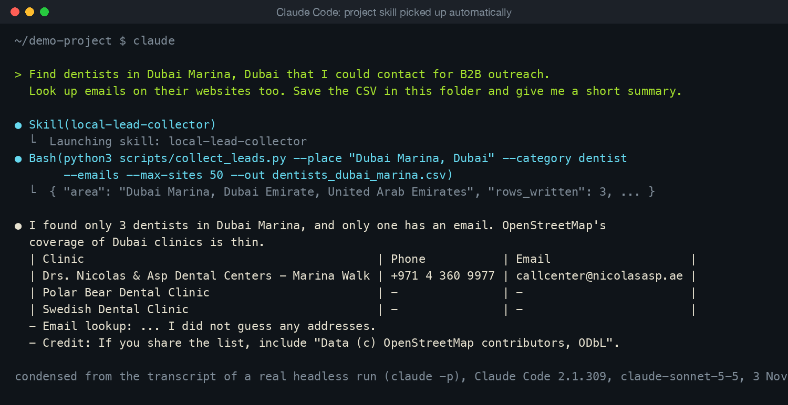
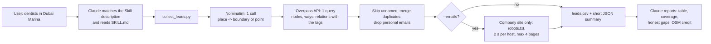

# Local Lead Collector: a Claude Skill

A reusable [Agent Skill](https://platform.claude.com/docs/en/agents-and-tools/agent-skills/overview) that turns a request like *"dentists in Dubai Marina"* into a clean CSV of local businesses: name, website, phone, a public business email, address and opening hours. It uses free OpenStreetMap data, so there is no account, no API key and no paid data service. Install it once and Claude picks it up whenever someone asks for leads, prospects or a company list for a place.



*Condensed from the transcript of a real headless Claude Code run (3 November 2026). The full transcript is in [examples/claude-code-run.md](examples/claude-code-run.md).*

## What is in the Skill

```
local-lead-collector/            <- the Skill folder (this is what you install)
  SKILL.md                       instructions + frontmatter Claude reads
  scripts/
    collect_leads.py             the command Claude runs; prints a short JSON summary
    overpass.py                  place name -> search area (Nominatim) -> Overpass query -> rows
    categories.py                plain-English categories mapped to OSM tags
    dedupe.py                    merges the same business mapped twice
    email_lookup.py              optional polite website email lookup
    polite_http.py               stdlib HTTP client: per-host delay, retries, size cap
  references/
    categories.md                every built-in category and its OSM tags
    overpass-notes.md            how the area is chosen, usage limits, troubleshooting
    compliance.md                what is collected, what is refused, cold email rules
tests/                           43 offline tests, all HTTP faked
tools/package_skill.py           builds the zip for claude.ai
examples/                        summaries of the real runs below
```

## How it works



Design choices that matter for a client:

- **Cheap on tokens.** The scripts do the fetching and filtering. Claude only reads a JSON summary of a few hundred tokens, never whole web pages. The Claude Code run below cost about $0.07 of usage.
- **Standard library only.** No `pip install`, so it runs on a fresh laptop and in sandboxes where installing packages is blocked.
- **Polite by default.** One Nominatim call per run (their limit is 1 a second), at least 5 seconds between Overpass calls, back-off on 429/504 honouring `Retry-After`, a User-Agent with a contact URL, and a community mirror only when the main Overpass server cannot be reached at all (never to dodge a "slow down").
- **No personal data.** Only role addresses (info@, reception@, bookings@, toimisto@, empfang@...) are kept, from OSM and from websites. Addresses that look like a named person are dropped and only counted. Social networks, Google Maps, WhatsApp links and directories are never fetched. robots.txt is obeyed.
- **No guessing.** No `firstname@company` patterns. An empty cell stays empty, and the Skill tells Claude to say so.
- **Spreadsheet-safe.** Cells that could run as a formula are escaped; phone numbers like `+971 4 ...` are left alone.

## Install

The Skill's name is `local-lead-collector`. (Anthropic's rules forbid the words "claude" and "anthropic" in a Skill name, which is why only the repo has "claude" in it.)

**Claude Code**, for one project:

```bash
git clone https://github.com/ParishSynthMind/claude-skill-local-lead-collector.git
mkdir -p your-project/.claude/skills
cp -R claude-skill-local-lead-collector/local-lead-collector your-project/.claude/skills/
```

or for every project on your machine: copy the folder to `~/.claude/skills/` instead. Start `claude` in the project and ask for leads, or type `/local-lead-collector`.

**Claude.ai** (any plan with code execution turned on):

```bash
python3 tools/package_skill.py        # writes dist/local-lead-collector.zip
```

Upload the zip under Customize > Skills and switch it on. The Skill needs internet access from Claude's sandbox: on personal plans turn on network egress under Settings > Capabilities; on Team and Enterprise the owner must allow `nominatim.openstreetmap.org` and `overpass-api.de` (plus "all domains" if you want the website email lookup). Not tested on claude.ai yet, see Status.

**Claude API**: Skills on the API run in a container with no network access, so this Skill cannot fetch data there. Use Claude Code or claude.ai.

## Run the scripts directly

```bash
cd local-lead-collector
python3 scripts/collect_leads.py --place "Dubai Marina, Dubai" --category dentist --out leads.csv
python3 scripts/collect_leads.py --place "Helsinki, Finland" --category dentist --require website --emails --max-sites 12
python3 scripts/collect_leads.py --bbox 25.10,55.18,25.13,55.21 --tag office=it --out it.csv
python3 scripts/collect_leads.py --help
```

Set `LEAD_COLLECTOR_CONTACT` to your own URL or email so server operators can reach you.

Note for macOS: the system `/usr/bin/python3` (3.9 with LibreSSL 2.8) fails the TLS handshake with overpass-api.de. Use a current Python, e.g. Homebrew's `python3.12`. The tests pass on both.

## Tests

```bash
python3 -m venv .venv && .venv/bin/pip install -r requirements-dev.txt
.venv/bin/pytest            # 43 tests, no network
```

They cover: the SKILL.md frontmatter against Anthropic's published rules (name format and reserved words, description length, only portable fields, every linked file exists, folder name matches), place matching for boundaries, outlines and points, the Overpass query text, tag injection, duplicate merging, robots.txt (disallow, 403, missing), role vs personal emails in several languages, the per-host delay and `Retry-After`, the size cap, the mirror rule, CSV formula escaping, exit codes and the claude.ai zip layout. GitHub Actions runs them on Python 3.9 and 3.12.

## Status

**Tested live on 3 November 2026** against the real public servers:

| Run | Result |
|---|---|
| Dentists, Dubai (city boundary), `--require any-contact --emails --max-sites 10` | 74 map features, 3 unnamed skipped, 3 duplicates merged, **23 rows** with a contact: 21 with a website, 18 with a phone, 17 with a role email. 2 personal emails mapped in OSM were dropped. 4 sites needed a lookup; 2 of their domains no longer resolve. 89 seconds. |
| Dentists, Dubai Marina (district boundary) | 3 rows, 1 with website, phone and email. 30 seconds. |
| Dentists, Dubai Marina, `--radius 3000` | 7 rows, 2 with a role email. 77 seconds. |
| Dentists, Helsinki, `--require website --emails --max-sites 12` | 72 features, **33 rows**. Of the first 12, 6 ended with a role email: 4 from OSM (Finnish ones like `toimisto@`, `vastaanotto@`) and 2 found on the company site (`info@`). 13 named-person addresses were dropped; 1 site answered 429 and was left alone. (Before the multilingual fix, the same run kept only 3.) |
| Claude Code 2.1.309, Skill as a project skill, headless `claude -p`, claude-sonnet-5-5 | Claude chose the Skill by itself from the description, ran the script, saved the CSV, reported the thin coverage honestly and guessed nothing. 6 turns, 117 seconds. |

Summaries of each run are in [examples/](examples/). The rows themselves are not committed; re-run to get them.

Live testing found and fixed four real problems, each now covered by a test: phone numbers were being escaped as formulas; `callcenter@` and Finnish role words like `toimisto@` were dropped as personal; a dead deep link stopped a site's lookup instead of falling back to its home page; and `--radius` was ignored when the place had a boundary (Claude tried to widen a search and got the same result).

Not tested yet: the claude.ai upload (needs a logged-in claude.ai account with code execution and network egress on; the zip is built and its layout is tested). The Skill cannot run on the Claude API because API Skills have no network.

## Honest limits

- **OpenStreetMap coverage varies a lot.** Helsinki is well mapped; Dubai Marina has far more dentists than the 3 mapped. For a complete list in some cities you need an official register (for Dubai clinics, the DHA facility list) or a paid data source.
- **OSM data can be out of date.** 2 of the 4 Dubai websites looked up no longer exist. The `osm_url` column links to each feature so anyone can check or fix it.
- **Big chains share one email.** Three Drs. Nicolas & Asp branches have different addresses and phones but the same call-centre email, so they stay as three rows.
- **Some sites block automated visits** (429 or a robots.txt "keep out"). The Skill backs off rather than working around it.
- **Legal:** the data is public business data, but sending cold email is still regulated (GDPR/PECR in Europe and the UK, the PDPL in the UAE, CAN-SPAM in the US). See [references/compliance.md](local-lead-collector/references/compliance.md). Credit "OpenStreetMap contributors" (ODbL) when sharing the list.

## Stack

Claude Agent Skills (SKILL.md, progressive disclosure, bundled scripts) · Python 3 standard library · OpenStreetMap Overpass API · Nominatim · pytest · GitHub Actions

---
Part of a small portfolio of tested automation/AI builds; see [ParishSynthMind](https://github.com/ParishSynthMind) for the others.
